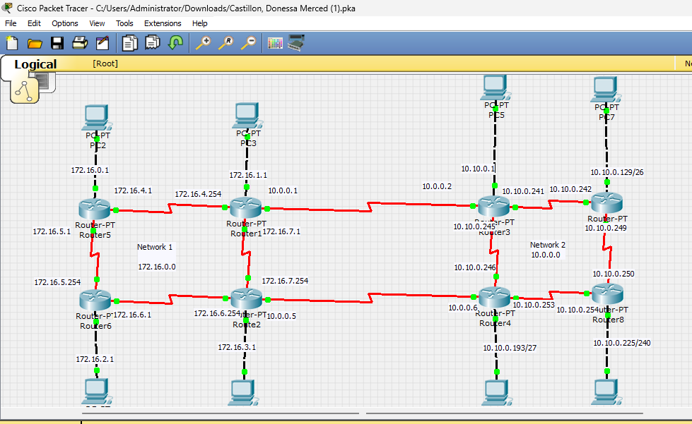
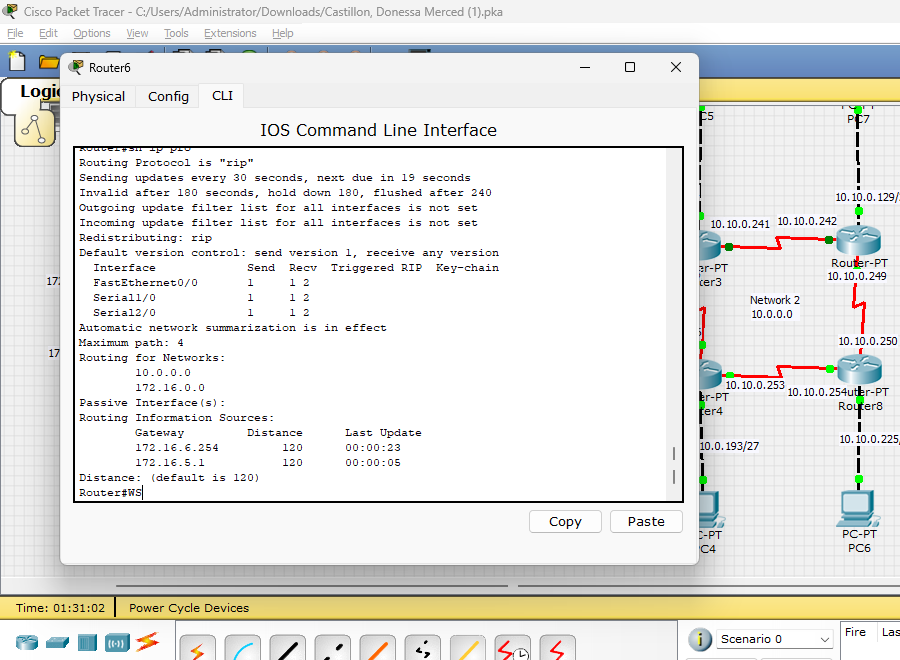
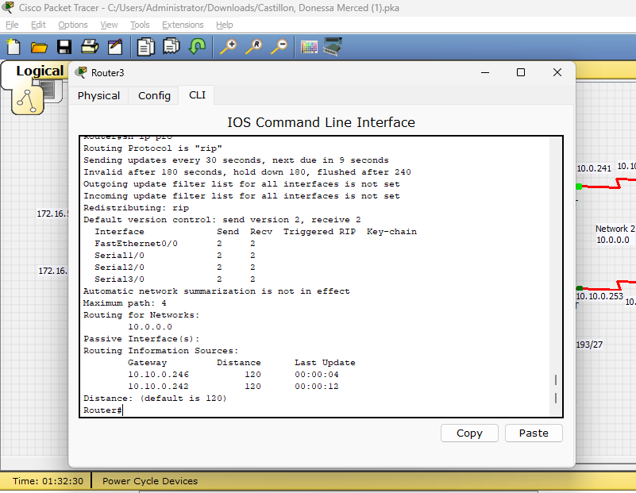
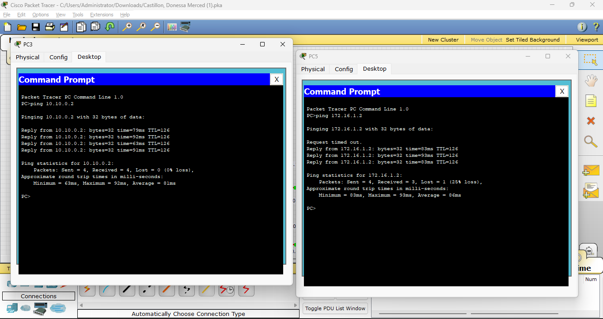

# RIPv1–RIPv2 Network Design and Implementation Documentation

**Project:** Dual-domain Cisco Packet Tracer network  
**Prepared for:** Network Routing Project  
**Date:** July 15, 2026  
**Status:** Implemented and connectivity-verified

---

## 1. Executive Summary

This project implements two routed network domains connected by two redundant WAN serial links:

- **Network 1 (left side)** uses the base block `172.16.0.0/21`, fixed-length `/24` subnets, and RIPv1.
- **Network 2 (right side)** uses the base block `10.10.0.0/24`, VLSM, and RIPv2.
- **The WAN boundary** uses `10.0.0.0/29`, divided into two `/30` point-to-point links.

The design contains eight routers, eight LANs, eight internal serial links, and two cross-domain WAN links. The left and right domains use different RIP versions, so their boundary interfaces require explicit RIP version compatibility. End-to-end ping tests confirm communication between a host in the RIPv1 domain and a host in the RIPv2 domain.

## 2. Project Objectives

The network was designed to:

1. Apply fixed-length subnetting to the left-side `172.16.0.0/21` allocation.
2. Apply VLSM efficiently to the right-side `10.10.0.0/24` allocation.
3. Use RIPv1 for the left routing domain and RIPv2 for the right routing domain.
4. Connect the routing domains using two independent `/30` WAN links.
5. Preserve RIPv2 VLSM information inside Network 2.
6. Provide alternate routing paths if an internal or boundary link fails.
7. Verify local and cross-domain reachability using IOS show commands and PC ping tests.

## 3. Logical Topology



**Figure 1.** Complete topology. Router1–Router3 form the upper WAN boundary, while Router2–Router4 form the lower WAN boundary.

The topology is arranged as two four-router rings:

- **Left ring:** Router5, Router1, Router2, and Router6.
- **Right ring:** Router3, Router7, Router8, and Router4.
- **Upper boundary:** Router1 to Router3.
- **Lower boundary:** Router2 to Router4.

Each router serves one directly connected PC LAN. The ring layout and the two WAN boundary links provide more than one possible path between the routing domains.

## 4. Addressing Design Summary

| Routing domain | Address block | Subnet method | Routing protocol | Allocation result |
|---|---:|---|---|---|
| Network 1 | `172.16.0.0/21` | Fixed-length `/24` | RIPv1 | Four LANs and four serial networks |
| Network 2 | `10.10.0.0/24` | VLSM | RIPv2 | Four variable-size LANs and four `/30` serial networks |
| WAN boundary | `10.0.0.0/29` | Two `/30` links | RIP boundary exchange | Router1–Router3 and Router2–Router4 |

### 4.1 Allocation validation

- A `/21` contains 2,048 addresses. Dividing it into `/24` networks produces exactly eight subnets, covering `172.16.0.0` through `172.16.7.255` without overlap.
- The right-side VLSM plan consumes the entire `/24`: 128 + 64 + 32 + 16 + 4 + 4 + 4 + 4 = 256 addresses.
- A `/29` contains eight addresses and divides exactly into the two required `/30` point-to-point links.

## 5. Network 1 — RIPv1 and Fixed-Length Subnetting

**Base network:** `172.16.0.0/21`  
**Subnet mask used throughout:** `255.255.255.0` (`/24`)  
**Routing protocol:** RIPv1

| Label | Connection | Network address | Prefix | Subnet mask | First usable | Last usable | Broadcast |
|---|---|---:|---:|---:|---:|---:|---:|
| LAN 1 | Router5–PC2 | `172.16.0.0` | `/24` | `255.255.255.0` | `172.16.0.1` | `172.16.0.254` | `172.16.0.255` |
| LAN 2 | Router1–PC3 | `172.16.1.0` | `/24` | `255.255.255.0` | `172.16.1.1` | `172.16.1.254` | `172.16.1.255` |
| LAN 3 | Router6–PC0 | `172.16.2.0` | `/24` | `255.255.255.0` | `172.16.2.1` | `172.16.2.254` | `172.16.2.255` |
| LAN 4 | Router2–PC1 | `172.16.3.0` | `/24` | `255.255.255.0` | `172.16.3.1` | `172.16.3.254` | `172.16.3.255` |
| Serial 1 | Router5–Router1 | `172.16.4.0` | `/24` | `255.255.255.0` | `172.16.4.1` | `172.16.4.254` | `172.16.4.255` |
| Serial 2 | Router5–Router6 | `172.16.5.0` | `/24` | `255.255.255.0` | `172.16.5.1` | `172.16.5.254` | `172.16.5.255` |
| Serial 3 | Router6–Router2 | `172.16.6.0` | `/24` | `255.255.255.0` | `172.16.6.1` | `172.16.6.254` | `172.16.6.255` |
| Serial 4 | Router1–Router2 | `172.16.7.0` | `/24` | `255.255.255.0` | `172.16.7.1` | `172.16.7.254` | `172.16.7.255` |

RIPv1 is classful and does not include subnet masks in its updates. Fixed `/24` subnetting is therefore used consistently inside the left routing domain.

## 6. Network 2 — RIPv2 and VLSM

**Base network:** `10.10.0.0/24`  
**Routing protocol:** RIPv2  
**Summarization setting:** `no auto-summary`

| Label | Connection | Network address | Prefix | Subnet mask | First usable | Last usable | Broadcast |
|---|---|---:|---:|---:|---:|---:|---:|
| LAN 1 | Router3–PC5 | `10.10.0.0` | `/25` | `255.255.255.128` | `10.10.0.1` | `10.10.0.126` | `10.10.0.127` |
| LAN 2 | Router7–PC7 | `10.10.0.128` | `/26` | `255.255.255.192` | `10.10.0.129` | `10.10.0.190` | `10.10.0.191` |
| LAN 3 | Router4–PC4 | `10.10.0.192` | `/27` | `255.255.255.224` | `10.10.0.193` | `10.10.0.222` | `10.10.0.223` |
| LAN 4 | Router8–PC6 | `10.10.0.224` | `/28` | `255.255.255.240` | `10.10.0.225` | `10.10.0.238` | `10.10.0.239` |
| Serial 1 | Router3–Router7 | `10.10.0.240` | `/30` | `255.255.255.252` | `10.10.0.241` | `10.10.0.242` | `10.10.0.243` |
| Serial 2 | Router3–Router4 | `10.10.0.244` | `/30` | `255.255.255.252` | `10.10.0.245` | `10.10.0.246` | `10.10.0.247` |
| Serial 3 | Router4–Router8 | `10.10.0.248` | `/30` | `255.255.255.252` | `10.10.0.249` | `10.10.0.250` | `10.10.0.251` |
| Serial 4 | Router7–Router8 | `10.10.0.252` | `/30` | `255.255.255.252` | `10.10.0.253` | `10.10.0.254` | `10.10.0.255` |

The VLSM allocation is ordered from largest to smallest LAN. The remaining sixteen addresses are divided into four `/30` point-to-point networks, each providing exactly two usable addresses.

## 7. WAN Boundary Addressing

**Base network:** `10.0.0.0/29`  
**Purpose:** Interconnection between the RIPv1 and RIPv2 routing domains

| Label | Connection | Network address | Prefix | Subnet mask | Left router IP | Right router IP | Broadcast |
|---|---|---:|---:|---:|---:|---:|---:|
| WAN 1 | Router1–Router3 | `10.0.0.0` | `/30` | `255.255.255.252` | `10.0.0.1` | `10.0.0.2` | `10.0.0.3` |
| WAN 2 | Router2–Router4 | `10.0.0.4` | `/30` | `255.255.255.252` | `10.0.0.5` | `10.0.0.6` | `10.0.0.7` |

## 8. Router Interface Address Register

The physical serial port numbers may vary according to the installed Packet Tracer modules. The logical link name should therefore be matched to the actual interface using `show ip interface brief` before pasting a configuration.

| Router | Logical interface/link | IPv4 address | Prefix |
|---|---|---:|---:|
| Router5 | LAN to PC2 | `172.16.0.1` | `/24` |
| Router5 | Serial to Router1 | `172.16.4.1` | `/24` |
| Router5 | Serial to Router6 | `172.16.5.1` | `/24` |
| Router1 | LAN to PC3 | `172.16.1.1` | `/24` |
| Router1 | Serial to Router5 | `172.16.4.254` | `/24` |
| Router1 | Serial to Router2 | `172.16.7.1` | `/24` |
| Router1 | WAN to Router3 | `10.0.0.1` | `/30` |
| Router6 | LAN to PC0 | `172.16.2.1` | `/24` |
| Router6 | Serial to Router5 | `172.16.5.254` | `/24` |
| Router6 | Serial to Router2 | `172.16.6.1` | `/24` |
| Router2 | LAN to PC1 | `172.16.3.1` | `/24` |
| Router2 | Serial to Router6 | `172.16.6.254` | `/24` |
| Router2 | Serial to Router1 | `172.16.7.254` | `/24` |
| Router2 | WAN to Router4 | `10.0.0.5` | `/30` |
| Router3 | LAN to PC5 | `10.10.0.1` | `/25` |
| Router3 | Serial to Router7 | `10.10.0.241` | `/30` |
| Router3 | Serial to Router4 | `10.10.0.245` | `/30` |
| Router3 | WAN to Router1 | `10.0.0.2` | `/30` |
| Router7 | LAN to PC7 | `10.10.0.129` | `/26` |
| Router7 | Serial to Router3 | `10.10.0.242` | `/30` |
| Router7 | Serial to Router8 | `10.10.0.253` | `/30` |
| Router4 | LAN to PC4 | `10.10.0.193` | `/27` |
| Router4 | Serial to Router3 | `10.10.0.246` | `/30` |
| Router4 | Serial to Router8 | `10.10.0.249` | `/30` |
| Router4 | WAN to Router2 | `10.0.0.6` | `/30` |
| Router8 | LAN to PC6 | `10.10.0.225` | `/28` |
| Router8 | Serial to Router4 | `10.10.0.250` | `/30` |
| Router8 | Serial to Router7 | `10.10.0.254` | `/30` |

## 9. End-Device Addressing

The first usable address on every LAN is assigned to the router and used as the default gateway. The sample PC assignments shown in the topology and connectivity test use the second usable address.

| PC | Connected router | IPv4 address | Subnet mask | Default gateway |
|---|---|---:|---:|---:|
| PC2 | Router5 | `172.16.0.2` | `255.255.255.0` | `172.16.0.1` |
| PC3 | Router1 | `172.16.1.2` | `255.255.255.0` | `172.16.1.1` |
| PC0 | Router6 | `172.16.2.2` | `255.255.255.0` | `172.16.2.1` |
| PC1 | Router2 | `172.16.3.2` | `255.255.255.0` | `172.16.3.1` |
| PC5 | Router3 | `10.10.0.2` | `255.255.255.128` | `10.10.0.1` |
| PC7 | Router7 | `10.10.0.130` | `255.255.255.192` | `10.10.0.129` |
| PC4 | Router4 | `10.10.0.194` | `255.255.255.224` | `10.10.0.193` |
| PC6 | Router8 | `10.10.0.226` | `255.255.255.240` | `10.10.0.225` |

## 10. Routing Protocol Implementation

### 10.1 RIPv1 domain

Router5 and Router6 require only the `172.16.0.0` classful network statement. Router1 and Router2 also activate RIP on their `10.0.0.0/30` WAN interfaces.

```text
router rip
 version 1
 network 172.16.0.0
 network 10.0.0.0
 passive-interface FastEthernet0/0
```

The `network 10.0.0.0` line is required only on Router1 and Router2. Router5 and Router6 should omit it because they have no directly connected `10.x.x.x` interface.

### 10.2 RIPv2 domain

All right-side routers use RIPv2 with automatic classful summarization disabled so that the `/25`, `/26`, `/27`, `/28`, and `/30` masks remain in routing updates.

```text
router rip
 version 2
 no auto-summary
 network 10.0.0.0
 passive-interface FastEthernet0/0
```

In Cisco IOS RIP configuration, `network 10.0.0.0` is a classful activation statement. It enables RIP on the connected `10.10.0.0/24` VLSM interfaces and the `10.0.0.0/29` WAN interfaces; it does **not** redefine Network 2 as `10.0.0.0`.

### 10.3 RIPv1/RIPv2 boundary compatibility

RIPv1 and RIPv2 do not exchange updates reliably if the RIPv2 WAN interface accepts only version 2. Apply interface-specific receive settings on both right-side boundary links:

```text
! Router3 interface facing Router1
interface <serial-to-Router1>
 ip rip receive version 1 2

! Router4 interface facing Router2
interface <serial-to-Router2>
 ip rip receive version 1 2
```

For an explicit, symmetric configuration, the left boundary interfaces can be set to send RIPv1 and receive RIPv2:

```text
! Router1 interface facing Router3, and Router2 interface facing Router4
interface <boundary-serial-interface>
 ip rip send version 1
 ip rip receive version 1 2
```

The right boundary routers continue sending RIPv2. The left routers can receive those updates and advertise a classful `10.0.0.0/8` reachability route inside Network 1. The right routers receive the RIPv1 `172.16.0.0/16` summary and advertise it through Network 2 using RIPv2.

### 10.4 Recommended operational settings

- Make each PC-facing FastEthernet interface passive so hosts do not receive RIP advertisements.
- Configure `clock rate` only on the DCE end of each serial connection.
- Apply `no shutdown` to every router interface.
- Keep `no auto-summary` on every RIPv2 router.
- Configure both WAN boundary interfaces for RIPv1 reception on the RIPv2 side to preserve redundancy.

## 11. Verification Evidence

### 11.1 RIPv1 verification



**Figure 2.** The `show ip protocols` output verifies RIP operation on the left. It shows version 1 transmission, RIPv1/RIPv2 reception capability, automatic summarization, and learned routing information from neighboring `172.16.x.x` routers.

### 11.2 RIPv2 verification



**Figure 3.** Router3 is operating with RIPv2, sends and receives version 2 on its internal interfaces, and has automatic summarization disabled. The listed sources `10.10.0.242` and `10.10.0.246` correspond to its Router7 and Router4 neighbors.

The captured Router3 output shows version-2-only reception on the displayed interfaces. For complete dual-WAN failover, the Router3 interface toward Router1 should be changed to `ip rip receive version 1 2`; the same rule applies to Router4 toward Router2.

### 11.3 Cross-domain ping verification



**Figure 4.** PC3 (`172.16.1.2`) successfully reaches PC5 (`10.10.0.2`), and PC5 successfully reaches PC3. The first request from PC5 times out while the remaining three replies succeed. In Packet Tracer, this commonly occurs during initial ARP resolution and does not indicate a persistent routing failure.

| Test | Source | Destination | Observed result | Status |
|---|---:|---:|---|---|
| Cross-domain ping 1 | PC3 (`172.16.1.2`) | PC5 (`10.10.0.2`) | 4 of 4 replies, 0% loss | Pass |
| Cross-domain ping 2 | PC5 (`10.10.0.2`) | PC3 (`172.16.1.2`) | 3 of 4 replies after initial timeout | Pass |
| RIPv1 operation | Router6 | `show ip protocols` | RIP version 1 transmission and neighbor updates shown | Pass |
| RIPv2 operation | Router3 | `show ip protocols` | RIP version 2 and `no auto-summary` shown | Pass |

## 12. Recommended Verification Commands

Run the following commands on every router after configuration or topology changes:

```text
show ip interface brief
show ip protocols
show ip route
show ip route rip
show interfaces serial
```

Recommended functional tests:

1. Ping each PC's default gateway.
2. Ping another LAN inside the same routing domain.
3. Ping from PC3 (`172.16.1.2`) to PC5 (`10.10.0.2`).
4. Ping from PC5 to PC3.
5. Shut down WAN 1 temporarily and repeat the cross-domain ping to test WAN 2.
6. Restore WAN 1, shut down WAN 2, and repeat the test through WAN 1.
7. Restore all interfaces and confirm both RIP paths return to the routing tables.

## 13. Troubleshooting Guide

| Symptom | Likely cause | Corrective action |
|---|---|---|
| A PC cannot reach its gateway | Incorrect PC mask/gateway or router LAN interface is down | Check the PC IPv4 settings and `show ip interface brief` |
| Left-side local routes are missing | RIPv1 not enabled on a `172.16.x.x` interface | Add `network 172.16.0.0` and verify the interface is up |
| Right-side VLSM routes appear with wrong masks | RIPv2 is missing or auto-summary is enabled | Configure `version 2` and `no auto-summary` |
| Right side cannot learn `172.16.0.0/16` over a WAN link | Boundary RIPv2 interface rejects RIPv1 updates | Configure `ip rip receive version 1 2` on that interface |
| Left side cannot reach `10.10.0.0/24` | Boundary update is missing or the left router has no route to `10.0.0.0/8` | Check RIP neighbors, boundary interface versions, and `show ip route rip` |
| Serial interface is down/down | Cable or module problem | Check the selected ports and physical connection |
| Serial interface is up/down | Encapsulation mismatch or missing DCE clock | Match encapsulation and configure DCE `clock rate` |
| First ping fails but later pings work | ARP resolution or initial route convergence | Repeat the ping after a few seconds |
| Failover works through only one WAN | Only one RIPv2 boundary interface accepts RIPv1 | Apply boundary compatibility to Router3 and Router4 |

## 14. Documentation Corrections and Notes

1. The right-side base allocation is **`10.10.0.0/24`**. If the topology label displays “Network 2 10.0.0.0,” it should be relabeled to `10.10.0.0/24`.
2. The separate **`10.0.0.0/29`** allocation belongs only to the two WAN boundary links.
3. The IOS command `network 10.0.0.0` under RIP is expected because IOS uses the classful major network in the RIP process. It does not conflict with the VLSM addressing table.
4. Router interface numbers are hardware-dependent in Packet Tracer. The IP-to-link assignments in this document are authoritative; confirm actual port numbers with `show ip interface brief`.
5. The supplied screenshots demonstrate successful end-to-end communication. A separate link-failure test should be captured if proof of both WAN paths is required for assessment.

## 15. Conclusion

The completed design meets the required subnetting and routing objectives. Network 1 uses all eight `/24` subnets derived from `172.16.0.0/21`, while Network 2 uses the complete `10.10.0.0/24` block efficiently through VLSM. Two `/30` WAN links derived from `10.0.0.0/29` connect the domains. RIPv1 supports the fixed-length left side, RIPv2 preserves the variable-length right side, and boundary interface version controls allow routes to pass between them. The supplied ping evidence confirms successful communication between hosts in the two routing domains.
